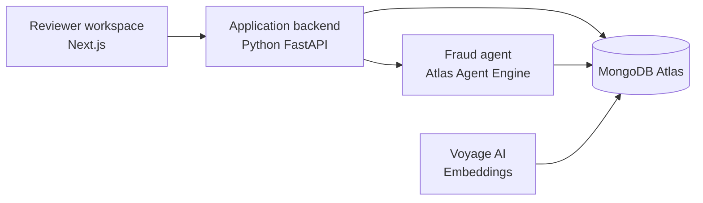

# Agentic Fraud Detection for Insurance Claims

An insurance claims review demo that brings together explicit fraud rules, semantic search over claims and fraud schemes, and human review. The agent gathers relevant evidence, explains its assessment, and recommends an outcome. A reviewer remains responsible for the final decision.

## The problem

Reviewers need to compare each claim with policy and customer context, known fraud indicators, and prior cases. Gathering that evidence manually takes time and makes it harder to apply expertise consistently and trace why a decision was made.

This solution helps assemble and explain the evidence in one workflow, while keeping the decision with the reviewer.

## What the solution does

* Brings claim, policy, customer, fraud-pattern, and review information into a claims-review workflow.
* Applies weighted, constraint-based rules to explicit claim fields.
* Uses MongoDB Atlas Vector Search to find semantically similar fraud schemes and resolved claims, even when their narratives use different wording.
* Presents a score, matched evidence, and a recommendation for reviewer consideration. Similar resolved claims provide context; they do not change the score.
* Records the assessment and the human decision, and uses reviewer outcomes to update the reliability statistics of matched patterns.
* Provides a reviewer workspace for the claims queue, assessment, decisions, pattern management, fraud intelligence, and audit history.

## Architecture

The solution has five main components:

* **Reviewer workspace — Next.js:** Supports claim review, decisions, pattern management, and portfolio-level fraud intelligence.
* **Application backend — Python FastAPI:** Coordinates requests between the reviewer experience, the agent, and the data layer. It also supports decision recording, pattern feedback, and analytics.
* **Fraud agent — Atlas Agent Engine:** Runs claim assessments and responds to reviewer questions using tools connected to MongoDB Atlas.
* **Embedding service — Voyage AI:** Converts claim narratives and fraud-scheme descriptions into vectors for semantic retrieval.
* **Data layer — MongoDB Atlas:** Stores claims, policies, customers, fraud patterns, embeddings, and decision traces. MongoDB Atlas Vector Search indexes vectors alongside the related documents.



### Assessment flow

1. A reviewer selects a claim for assessment. The backend supplies the agent with the required checks; the reviewer can add a focus area without replacing those checks.
2. The agent gathers the claim, policy, and customer context, evaluates applicable rules, and searches for relevant fraud schemes and resolved claims.
3. The solution totals the weights of fired rules and qualifying schemes, caps the score at 12, and presents the calculation and supporting evidence. Similar resolved claims are evidence, not score inputs.
4. The reviewer can ask follow-up questions, then confirms or dismisses the claim.
5. The application records the human decision and assessment trace. Reviewer outcomes update the reliability statistics for matched patterns.

MongoDB Atlas is both the operational data store and semantic memory for the solution. Vector Search operates on embeddings stored with claims and fraud patterns, so the agent can retrieve relevant context from the same data layer used by the rest of the application.

## Atlas Agent Engine foundation

Atlas Agent Engine provides the managed platform layer for the fraud agent: agent execution, memory and retrieval, and governance. This lets the solution focus on its insurance-specific assessment workflow—what evidence to gather, how to evaluate it, and what recommendation to present—rather than assembling those platform capabilities itself.

The Engine also supports isolated execution, least-privilege authorization for tool calls, and traces of model calls, tool calls, and memory access. These platform traces complement the application's decision record: Engine traces describe agent execution, while the application records the assessment and the reviewer's verdict.

The Engine runs and governs the agent; it does not replace the insurer's fraud policy or the reviewer's authority. The agent recommends, and the reviewer makes the final claim decision. Atlas Agent Engine also supports pause-and-resume human review checkpoints for workflows that need them; those platform checkpoints are distinct from the claim decision recorded by this demo.

## Set up the solution

### Time and readiness

**Target: about 25–30 minutes once prerequisites and access are ready.** This estimate assumes you already have an Atlas cluster, an Atlas Agent Engine organization and project, the required accounts and credentials, and access to the demo data. First-time account setup, access approvals, cluster provisioning, index building, or a large embedding backfill can take longer.

The setup deploys the agent first, then prepares and starts the backend, and finally starts the frontend. Use a demo database only: the seed step clears and reloads the demo collections.

### Prerequisites

Have these ready before starting:

* A MongoDB Atlas project and cluster, with permission to configure database access and network access.
* Access to an Atlas Agent Engine organization and project, plus the `agentengine` CLI installed and authenticated.
* Git and Docker running locally.
* Python 3.13 and `uv` for the backend.
* Node.js 22 or newer and npm for the frontend.
* A Voyage AI account and access to an LLM provider configured for the agent (Anthropic, OpenAI, or Google Gemini).
* Network access from the agent to the Atlas cluster and selected LLM provider.

### 1. Clone the repository

```bash
git clone https://github.com/mongodb-industry-solutions/ins-agentic-fraud-detection.git
cd ins-agentic-fraud-detection
```

### 2. Configure and deploy the agent

Move into the agent workspace and create a local configuration file from its example:

```bash
cd agents/insurance-fraud-agent
cp env.example .env
```

Open the new file and fill it with your own values. Use the same business database that the backend will use, and keep the Agent Engine runtime-store database separate. Add your chosen LLM provider and Voyage AI credentials. Do not commit the local file or copy its contents into documentation.

Review the agent configuration before deployment. Confirm its entry point, memory and guardrail settings, available tools, and outbound network policy. Allow the agent to reach the selected LLM provider and Atlas cluster. If you change the agent configuration, regenerate the local platform configuration:

```bash
agentengine init --force
```

Authenticate, initialize the workspace, and connect it to Atlas:

```bash
agentengine auth login
agentengine init
agentengine atlas setup
```

Add the selected LLM provider credential as an Atlas Agent Engine platform secret, using the secret name expected by the agent, then synchronize platform secrets:

```bash
agentengine secret set <secret-name>
agentengine secret sync
```

Deploy the agent:

```bash
agentengine deploy --auto
```

After deployment, keep the project and workspace identifiers and invocation address available for the backend's local configuration. Treat credentials and deployment details as private; do not commit them.

### 3. Prepare and start the backend

Open a terminal at the repository root. Create the backend's local configuration file from its example:

```bash
cp backend/.env.example backend/.env
```

Fill it with your own Atlas connection and database details, Voyage AI credentials, and the credentials and deployment details for the agent you just deployed. Use the same business database configured for the agent.

Install the backend dependencies and load the demo data:

```bash
make uv_init
make uv_sync
make seed
```

Make sure the approved demo data is available before seeding. If the seed command reports missing input data, obtain the demo data through the approved project process before continuing. Seeding clears and reloads the demo collections; do not run it against data you need to preserve, and keep the confirmation step enabled.

### 4. Create vector indexes and embeddings

Create two MongoDB Atlas Vector Search indexes on the `embedding` field:

* `claim_vector_index` on the `claims` collection.
* `fraud_pattern_vector_index` on the `fraud_patterns` collection.

Use **1,024 dimensions** and **cosine similarity**. The backend includes a helper for creating these indexes at `backend/_vector_search_idx_creator.py`.

Generate embeddings for the fraud-pattern descriptions and claim narratives:

```bash
cd backend
uv run python scripts/backfill_embeddings.py
uv run python scripts/backfill_embeddings.py --collection claims
cd ..
```

Wait for the indexes to become available before testing similarity-based retrieval. The Atlas indexes and generated embeddings must use the same vector dimensions.

### 5. Start the backend

From the repository root, start the FastAPI service in its own terminal:

```bash
make run-backend
```

The backend health check is available at `http://localhost:8000/health`; interactive API documentation is at `http://localhost:8000/docs`.

### 6. Configure and start the frontend

In another terminal at the repository root, create a local frontend configuration file from its example:

```bash
cp frontend/EXAMPLE.env frontend/.env.local
```

Fill in your own values, using the same Atlas connection and database as the backend. Install the frontend dependencies and start the app:

```bash
cd frontend
npm install
cd ..
make run-frontend
```

Open the demo at `http://localhost:3000`.

### 7. Verify the end-to-end workflow

1. Open the demo and confirm that the claims workspace loads.
2. Select a claim and start an assessment. Confirm that the agent returns a score, matched evidence, and a recommendation.
3. Ask a follow-up question if needed, then record a reviewer decision.
4. Confirm that the claim reflects the decision and that the review has an audit record.


## Run each part again

After completing setup, use these commands from the repository root:

* **Backend:** `make run-backend`
* **Frontend:** `make run-frontend`
* **Agent deployment:** from `agents/insurance-fraud-agent`, run `agentengine deploy --auto` after making and validating agent changes.

Keep the backend and frontend running in separate terminals while using the demo.

## Troubleshooting

| Symptom | What to check |
|---|---|
| The agent cannot connect to Atlas or its model provider | Confirm Atlas network access and that outbound access is allowed for the selected provider. Review the agent's local configuration and platform secret setup. |
| Agent deployment fails | Confirm CLI authentication, organization/project access, workspace initialization, and Atlas setup. If the agent configuration changed, run `agentengine init --force` before deploying again. |
| The backend cannot reach Atlas | Confirm that the Atlas cluster is reachable from your network and that the backend and agent use the same business database. |
| Seeding reports that input data is missing | Obtain the approved demo data before retrying. Do not proceed with an empty or unintended database. |
| Similar claims or schemes are not returned | Confirm that both vector indexes are active, embeddings were generated for both collections, and the index dimensions and similarity metric match the setup above. |
| The assessment cannot reach the deployed agent | Recheck the backend's local agent connection details and credentials against the deployed workspace. Keep these values private. |
| The frontend does not load data | Confirm that the backend is running and that the frontend's local configuration points to the intended demo database. |

## Security and data handling

Keep local configuration files and credentials out of version control. Use a demo database for seed and assessment workflows, and do not store confidential customer data in the demo environment.
